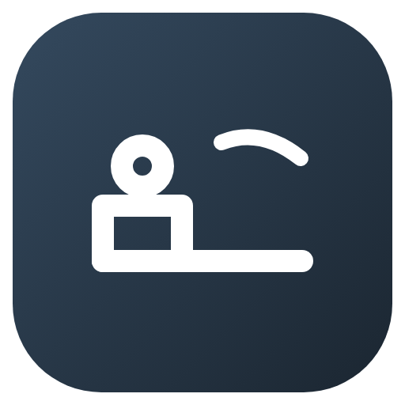

<h1 align="center">SleepAnimation: Full Russian Localization</h1>

  Russian configuration and translation package for SleepAnimation plugin v1.0.3.1. 
  Русская конфигурация и пакет локализации для плагина SleepAnimation v1.0.3.1.

  
  
  

  <a href="#english">English</a> | <a href="#русский">Русский</a>

---

## English

### Overview

This repository provides clean, standalone Russian localization files for **SleepAnimation v1.0.3.1**.
It contains only configuration and text files to respect original author licensing and copyright requirements.

### Files

- `config.yml`: Localized configuration with Russian comments.

### Installation

1. Copy `config.yml` into `plugins/SleepAnimation/`.
2. Download pre-built `.jar` with bytecode-patched Russian broadcast messages from [Releases](https://github.com/milkycloud-dev/sleepanimation-full-russian-localization/releases/latest).

### Releases

Pre-built ready-to-use binaries (`.jar` / `.zip`) are available for download in [Releases](https://github.com/milkycloud-dev/sleepanimation-full-russian-localization/releases/latest).

### License

MIT License. Created by milkycloud-dev (2026).

---

## Русский

### Описание

Репозиторий содержит чистые файлы русской локализации для **SleepAnimation v1.0.3.1**.
В состав включены исключительно файлы конфигурации и переводов, без бинарных сборок, с соблюдением требований лицензий авторов.

### Файлы

- `config.yml`: Локализованный конфигурационный файл с комментариями.

### Установка

1. Скопируйте `config.yml` в `plugins/SleepAnimation/`.
2. Скачайте готовую сборку `.jar` с русифицированными оповещениями из раздела [Releases](https://github.com/milkycloud-dev/sleepanimation-full-russian-localization/releases/latest).

### Релизы

Готовые собранные бинарные пакеты (`.jar` / `.zip`) доступны для загрузки в разделе [Releases](https://github.com/milkycloud-dev/sleepanimation-full-russian-localization/releases/latest).

### Лицензия

MIT License. Создано milkycloud-dev (2026).
